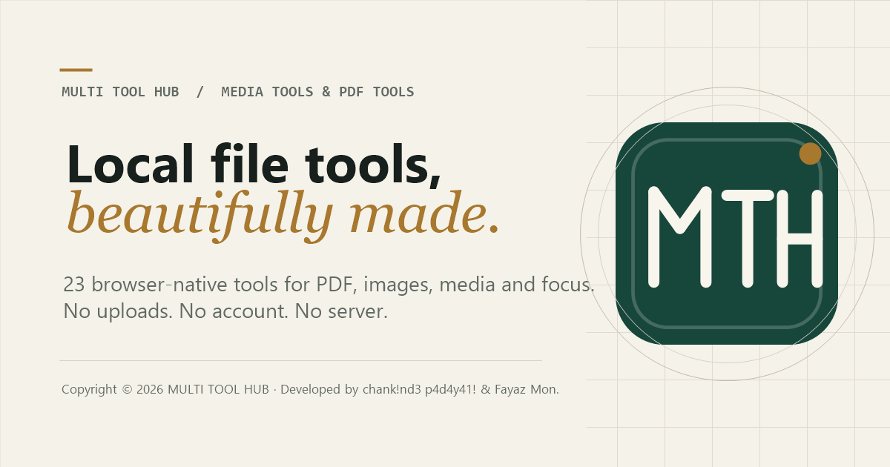

# MULTI TOOL HUB

**Version 6.0** — the corporate, local-first productivity suite for PDFs, images, media and downtime.

A high-end, static, browser-native collection of tools for PDFs, images and media, wrapped in a polished corporate white/dark-neutral design system. The interface uses subtle 3D depth, restrained motion and a bold typographic identity. There is no account, no tracking and no server-side processing for the local tools. Files never leave the device.

> **Credit:** `© 2026 MULTI TOOL HUB · Developed by chank!nd3 p4d4y41! l FAYAS MONU`



---

## What is inside

| Area | Tools |
| --- | --- |
| **PDF Studio** | PDF Viewer & Editor · Merge PDF · Split PDF · Organize Pages · Rotate PDF · Compress PDF · Crop PDF · Page Numbers · Watermark · PDF to Word · PDF to Text · PDF to JPG · JPG to PDF · Images to PDF |
| **Image Lab** | Image Compressor · Background Removal · Image Convert · Images to PDF |
| **Media Desk** | Video to MP3 · Video Compress · Video to Audio · YouTube Downloader · Instagram Downloader |
| **After Hours** | Ambient Studio · Chromatic Lab · Breathing Room · Focus Studio |

### Highlights

- **A complete PDF editor** — sticky comments, annotations, text editing, typography controls (19-font picker, bold/italic, alignment, line spacing, text background), highlight, underline, strike-through, freehand ink, lines/arrows, shapes, whiteout, true redaction boxes, image stamps, typed or drawn signatures, replace-text flows, undo/redo, page reorder/rotate/duplicate/delete/blank/merge/split/extract, and per-page or flattened export. Vector text export uses standard PDF fonts where possible; other glyphs render at high resolution.
- **Batch PDF conversion** — multi-PDF to images (ZIP) and multi-image to PDF (optionally one PDF per image, ZIP).
- **Precision PDF crop** — eight handles, numeric insets in %, mm, in or pt, aspect presets, auto-trim, page ranges, live preview.
- **PDF to Word** — real `.docx` output with headings, paragraphs, lists and tables; warns on scanned pages.
- **Large interactive previews** — fit-to-page, reduced zoom, scrollable preview frames, composited overlay layers.
- **Search built for intent** — word-level matching, typo tolerance, category filtering, favourites, recents, keyboard navigation.
- **Hub Assistant (extreme mode)** — client-side conversational memory and context, contextual greetings and follow-ups, tool ranking/open/explain, calculators, unit conversions, date math, text tools, password/UUID/Base64/SHA-256 helpers, aspect/transfers, theme switching, FAQ, optional bring-your-own-key streaming model, markdown replies, memory drawer, chat persistence.
- **After Hours** — Web Audio ambient soundscapes, canvas chromatic colour lab with gradient export, guided breathing rhythms, and the Focus Studio (timer, tasks, deliberate breaks).
- **Installable PWA** — offline-capable app shell, service worker, installable metadata.
- **Design system** — corporate white/dark-neutral tokens, bold fixed MTH mark, 3D tilt/reveal motion, reduced-motion support, responsive layouts, mobile navigation drawer, dark/light themes.

---

## Quick start

1. Unzip or copy the whole folder.
2. Open `index.html` in a modern browser (Chrome, Edge, Firefox or Safari).
3. That is it. A local static server is optional but recommended for service-worker, clipboard and fullscreen behaviour.

```powershell
# Python 3
python -m http.server 8080
```

```powershell
# Node.js
npx serve .
```

Then visit <http://localhost:8080>.

> The PDF, image and audio engines load from public CDNs (pdf.js, pdf-lib, JSZip, docx, lamejs, Font Awesome). The pdf.js worker is self-hosted, so rendering keeps working offline. The first visit needs an internet connection for the CDN libraries; afterwards the service worker caches them.

### Hub Assistant (client-side)

The v6 assistant runs primarily client-side:

- Persistent conversational memory (per device) with context recall.
- Intent router: greetings, tool questions, calculations, conversions, dates, text utilities, security/password/identity helpers, media helpers, theme, FAQ.
- Contextual responses and follow-ups.
- Optional bring-your-own-key streaming model (never a hosted key).
- Markdown rendering, speech synthesis, chat persistence, memory and settings drawers.

---

## Deploying

The site is plain HTML, CSS and JavaScript - no build step.

- **GitHub Pages / Netlify / Cloudflare Pages / Vercel / any static host:** upload the folder contents keeping the structure.
- **Keep `sw.js` at the site root.** Service workers only control pages at or below their own folder.

### Before going live

1. Replace the placeholder domain in `sitemap.xml` / `robots.txt` if you use them.
2. Keep `sw.js` cache version current (currently `mth-v6.0.0`).
3. **HTTPS is required** for the service worker and installation (localhost is exempt).
4. **Test in a private window** after deployment so an older service worker does not serve stale files.

---

## Privacy model

- **Local tools** read files with the browser's File API and process them in memory. Nothing is uploaded.
- **YouTube and Instagram helpers** are the only tools that contact a third party (Loader.to) to fetch public download options.
- **The assistant sends nothing until you message it**, and only then to the model you configure.
- **No analytics, no advertising, no accounts, no tracking pixels.**

Chat history, favourites, theme and recents are stored in `localStorage` on the device.

---

## Project structure

```text
index.html                  Home page, command deck, dynamic catalogue, showcases
entertainment.html          After Hours: ambient, chromatic, breathing, focus
tools/                      One self-contained HTML file per tool
assets/
  css/                      Design tokens, base, home, tool, legal, v6 design system
  js/                       core, registry, assistant, v6 shell, pages, tools
  logo-mark.svg             Bold geometric MTH mark (favicon)
  icons/                    App icons
  og-cover.png              Social sharing image
  vendor/                   pdf.js, pdf-lib, JSZip, docx, lamejs
sw.js                       Offline cache (root scope)
manifest.webmanifest        Installable app metadata
offline.html / 404.html     Offline fallback and not-found
legal/                      privacy.html / terms.html
entertainment.js           After Hours audio, canvas and breathing engines
assets/js/tools/viewer.js PDF viewer/editor engine (annotations, comments, export)
```

---

## Browser support

| Browser | Status |
| --- | --- |
| Chrome / Edge 100+ | Full support |
| Firefox 100+ | Full support (a few codecs depend on the OS) |
| Safari 15.4+ | Most tools; MP3 encoding and some canvas filters may vary |
| Mobile browsers | Responsive UI; very large PDFs may be limited by device memory |

---

## Notes and limits

- Editing existing text in the PDF Editor places a clean cover over the original glyphs; use **Redact** when content must be removed, **Flatten** for a single non-editable result.
- Scanned PDFs have no text layer; OCR is not included.
- The downloaders depend on the third-party Loader.to service; the other tools are unaffected.
- The legal pages are general templates, not legal advice.

---

## Credits

Designed and built for **MULTI TOOL HUB** by **FAYAS MONU**.

Credit line: `© 2026 MULTI TOOL HUB · Developed by chank!nd3 p4d4y41! l FAYAS MONU`

Open-source libraries: [pdf.js](https://mozilla.github.io/pdf.js/), [pdf-lib](https://pdf-lib.js.org/), [JSZip](https://stuk.github.io/jszip/), [docx](https://docx.js.org/), [lamejs](https://github.com/zhuker/lamejs), [Font Awesome](https://fontawesome.com/).

---

&copy; 2026 MULTI TOOL HUB.
