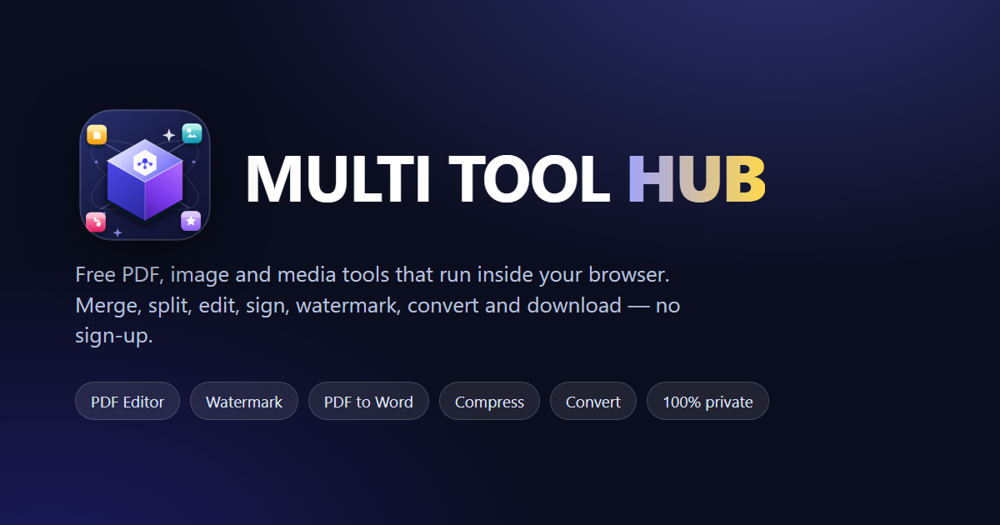

# MULTI TOOL HUB

A fast, privacy-first collection of **17 browser tools** for PDFs, images and media. The interface is a clean navy, blue and white workspace built for everyday office work. There is no account, no upload for the local tools, and no watermark added to your output.

> **Credit:** `chank!nd3 p4d4y41!.I FAYAS MONU`
> **Instagram:** [@____fa_y_as_____](https://www.instagram.com/____fa_y_as_____)



---

## What is inside

| Area | Tools |
| --- | --- |
| **Organise** | Merge PDF · Split PDF · Organize Pages · Rotate PDF |
| **Optimise** | Compress PDF |
| **Convert** | PDF to Word · PDF to Text · PDF to JPG · JPG to PDF |
| **Edit** | PDF Editor · Crop PDF · Page Numbers · Watermark |
| **Images** | Image Compressor |
| **Media** | Video to MP3 · YouTube Downloader · Instagram Downloader |

### Highlights

- **A complete PDF editor** - edit existing text, add wrapped text boxes with a 19-font picker, bold/italic, alignment, line spacing, text background, highlight, underline, strike-through, freehand pen, lines, arrows, rectangles, ellipses, solid/dashed/dotted strokes, whiteout, true redaction boxes, images, typed or drawn signatures, sticky comments and PDF form fields. Text-edit covers sample the page background so tinted pages stay clean. Geometry is set with exact numbers - X, Y, width, height, font size, spacing and opacity - rather than fiddly drag handles. Reorder, duplicate, arrange, delete, rotate, insert blank pages, merge another PDF, extract pages, focus the canvas, undo/redo, and save the current page or every page as a flattened copy.
- **Precision PDF crop** - eight independent handles (four edges and four corners), numeric insets in %, mm, in or pt, aspect presets including 1:1, auto-trim of detected margins, page-range controls and a live result preview.
- **PDF to Word** - builds a real `.docx` with headings, paragraphs, lists and tables. It uses the correct page viewport, so text lands in the right place, and warns you when a page is scanned instead of silently producing an empty file.
- **Large, interactive previews** - Watermark, Page Numbers, Crop, PDF to JPG, Image Compressor and Video to MP3 preview before you commit. The expand control opens a viewport-sized modal with zoom, fit, actual size, pan, a live state indicator and a download button. Stacked overlay layers (watermark, page numbers, crop guides) are composited into the enlarged image.
- **Search built for intent** - word-level matching, plural and stopword handling, exact source-to-target direction (so "pdf to word" never returns "word to pdf"), typo tolerance, category filtering, favourites, recent tools and keyboard navigation.
- **Hub Assistant** - a local, rule-based assistant that finds the right tool from a plain sentence, explains steps, checks file types and sizes, supports voice input, and can switch the theme. It runs entirely in your browser by default.
- **Optional Gemini connection** - two explicit modes: a **Browser key** stored only in this tab's `sessionStorage`, or a **Secure proxy** that keeps the key on your server. The local assistant remains the default and the fallback. No API key is hardcoded in this repository.
- **Installable PWA** - works from the home screen and keeps previously opened pages available offline.
- **Dark / light theme**, keyboard shortcuts, drag-and-drop, mobile-first layouts, a mobile navigation drawer, reduced-motion support and readable contrast in both themes.

---

## Quick start

1. Unzip or copy the whole folder.
2. Open `index.html` in a modern browser (Chrome, Edge, Firefox or Safari).
3. That is it. A local static server is optional, but recommended if you want the service worker, clipboard and some browser features to behave exactly as they do in production.

### Run a local server (optional)

Any static server works. Two easy options:

```powershell
# Python 3
python -m http.server 8080
```

```powershell
# Node.js
npx serve .
```

Then visit <http://localhost:8080>.

> The PDF, image and audio engines load from public CDNs (pdf.js, pdf-lib, JSZip, docx, lamejs, Font Awesome). The pdf.js worker is self-hosted (`assets/pdf.worker.min.js`), so rendering keeps working offline. The first visit needs an internet connection for the CDN libraries; afterwards the service worker caches them. The interface itself uses the system font stack - no Google Fonts request is made.

### Connect Gemini (optional)

The assistant is local by default and needs no account or key. Open **Assistant > Gemini** and choose one mode:

**Browser key**

1. Create a key in [Google AI Studio](https://aistudio.google.com/apikey).
2. Paste it into the Browser key field and press **Connect**.
3. The key is kept in `sessionStorage` for this tab only and sent directly to `https://generativelanguage.googleapis.com/v1beta`. It is never written to `localStorage`, the page source or this repository.
4. Press **Forget key** or close the tab to remove it. A key rejected by Google (HTTP 401/403) is cleared automatically.
5. To reduce risk, restrict the key in Google Cloud/AI Studio and never reuse a key that has been shared or committed.

**Secure proxy**

1. Deploy the small proxy in `server/` (Node.js 18+).
2. Set `GEMINI_API_KEY` in its environment; never in client code.
3. In the app, choose **Secure proxy**, enter the proxy URL (for example `https://api.example.com/api/assistant`) and an access token if configured.
4. The key stays on the server. Only chat text is sent. Local mode remains available if the proxy fails.

The proxy exposes `GET /api/assistant` for a connection check and `POST /api/assistant` for chat. See `server/README.md` for deployment, origin allow-listing, rate limits and security notes.

> **Security:** never commit an API key. If a key is ever exposed in a screenshot, chat, issue or commit, revoke it in Google AI Studio and create a new one. The Browser key mode is convenient, but a proxy is the stronger option for a public deployment.

---

## Deploying

The site is plain HTML, CSS and JavaScript - no build step.

- **GitHub Pages:** upload the folder contents to the repository root and enable Pages. The site uses relative paths and a service worker scoped to the folder, so it works at `https://user.github.io/repository/` as well as on a custom domain. `404.html` resolves the site root before loading assets.
- **Netlify / Cloudflare Pages / Vercel:** drag the folder in, or connect the repository. No build command; publish directory is the folder root.
- **Any shared host:** upload all files, keeping the folder structure.

### Before going live

1. **Replace the placeholder domain.** `sitemap.xml` and `robots.txt` use `https://multitoolhub.example/`. Replace it with your real domain. If you do not want a sitemap, delete it. Social images use relative paths so they resolve on any host; add absolute `og:url`/`og:image` URLs if your sharing platform requires them.
2. **Keep `sw.js` at the site root.** Service workers only control pages at or below their own folder.
3. **Bump the cache name** in `sw.js` (`const CACHE = "mth-v16";`) whenever you change HTML, CSS or JS. This forces visitors to receive the new files.
4. **HTTPS is required** for the service worker and installation (localhost is exempt).
5. **Test in a private window** after deployment so an older service worker does not serve stale files.

---

## Privacy model

- **Local tools** read files with the browser's File API and process them in memory. Nothing is uploaded.
- **YouTube and Instagram helpers** are the only tools that contact a third party. They send the public link you paste to the **Loader.to** API to fetch download options. This is disclosed on the pages, in the assistant and in the Privacy Policy.
- **Gemini is opt-in.** If you connect it, your chat text, the page path and normal request metadata are sent to Google. In Browser key mode the key goes from your browser to Google; in proxy mode it stays on your server. No file is ever sent. If you never connect, the assistant stays fully local.
- **Site files** (HTML, CSS, JS, icons) are served by your host or CDN, which will see normal request data such as IP address and user agent.
- **No analytics, no advertising, no accounts, no tracking pixels** are included.
- Chat history, favourites, theme and recent tools are stored in `localStorage` on your device. The Gemini key and proxy token are stored only in `sessionStorage` and cleared when the tab closes or you press **Forget key** / **Disconnect**. Legal pages list every key used.

The legal pages cover India (DPDP Act 2023, IT Act and rules, Consumer Protection Act) and the UAE (PDPL and consumer-protection rules), including the optional Gemini connection. They are detailed templates, not legal advice.

The full text is in [privacy.html](privacy.html) and [terms.html](terms.html).

---

## Project structure

```text
index.html                  Home page, tool grid, favourites and recents
manifest.webmanifest        Installable app metadata
sw.js                       Offline cache (root scope)
offline.html                Offline fallback
404.html                    Not-found page
terms.html / privacy.html   Legal pages
robots.txt / sitemap.xml    Search-engine files
assets/
  logo.svg                  Light-theme MULTI TOOL HUB lockup
  logo-dark.svg             Dark-theme lockup (white wordmark, blue mark)
  gemini.svg                Gemini mark used in the assistant
  icon-192.png              Home-screen icon
  icon-512.png              Large icon
  icon-maskable-512.png     Android adaptive icon
  og-cover.png              Social sharing image
  style.css                 Design system and shared components
  app.js                    Shared helpers (PE.*) and preview compositor
  pdf.worker.min.js         Self-hosted pdf.js worker (works offline)
  chat.js                   Hub Assistant (local rules + optional Gemini client)
tools/                      One self-contained HTML file per tool
server/                     Optional Node.js static host + secure Gemini proxy
  server.js                 No dependencies; key stays in the server env
  README.md                 Deployment and security notes
  .env.example              Copy to .env and add GEMINI_API_KEY
```

`assets/app.js` exposes small helpers used by every tool:

- `PE.openPdf(file)` - read a File/Blob safely with pdf.js
- `PE.preview(...)` - render page previews
- `PE.ranges("1-3,5,8-")` - parse page ranges (0-based by default)
- `PE.zip(files, name)` - build a ZIP
- `PE.openPreview(...)` - open the large zoomable preview modal
- `PE.download`, `PE.toast`, `PE.status`, `PE.progress`, `PE.run` - UI and error handling

---

## Browser support

| Browser | Status |
| --- | --- |
| Chrome / Edge 100+ | Full support |
| Firefox 100+ | Full support (a few codecs depend on the OS) |
| Safari 15.4+ | Most tools; MP3 encoding and some canvas filters may vary |
| Mobile browsers | Responsive UI; very large PDFs may be limited by device memory |

Video to MP3 depends on the browser being able to decode the source codec. If the browser cannot decode a file, the tool tells you instead of producing a broken download.

---

## Notes and limits

- Editing existing text in the PDF Editor places a clean cover over the original glyphs. It looks correct, but the old text can still exist underneath. Use the **Redact** tool when content must be removed, and use **Flatten** when you need a single non-editable result.
- Scanned PDFs have no text layer. PDF to Word and PDF to Text will report this; OCR is not included.
- The PDF Editor offers Helvetica, Arial, Times New Roman, Courier New, Verdana, Georgia, Comic Sans, Trebuchet MS and other common families. Helvetica/Arial, Times New Roman and Courier New export as real vector text (Arial and Courier New use the metric-compatible PDF standard fonts), so the text stays selectable. Other fonts and characters outside the PDF standard Latin set are rendered into the page at high resolution: they look exactly as designed but are not selectable. The save dialog says how many boxes this affects.
- Protect PDF (encryption) is intentionally not offered because pdf-lib cannot write encryption. A broken "protection" button would be worse than no button.
- The downloaders depend on the third-party Loader.to service. If that service is unavailable or changes its rules, those two tools may stop working; the other 15 tools are unaffected.
- The legal pages are detailed general templates, not legal advice. Have them reviewed for your jurisdiction if you rely on the site commercially.

---

## Credits

Designed and built for **MULTI TOOL HUB** by **FAYAS MONU**.

Credit line: `chank!nd3 p4d4y41!.I FAYAS MONU`

Open-source libraries: [pdf.js](https://mozilla.github.io/pdf.js/), [pdf-lib](https://pdf-lib.js.org/), [JSZip](https://stuk.github.io/jszip/), [docx](https://docx.js.org/), [lamejs](https://github.com/zhuker/lamejs), [Font Awesome](https://fontawesome.com/), and the optional [Gemini API](https://ai.google.dev/). The interface uses system fonts; Google Fonts is not loaded.

---

&copy; 2026 MULTI TOOL HUB. Free to use; please keep the credit line.
